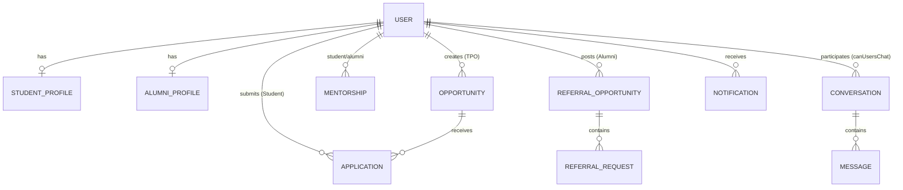

# CareerBridge — Phase 15: Seed Data Documentation

This document describes the Phase 15 Seed Data system for **CareerBridge — Campus Placement, Internship & Alumni Career Network**.

---

## 1. Overview

The seed system populates CareerBridge with interconnected, realistic fictional data so its features can be demonstrated convincingly during project reviews, college presentations, and campus placement evaluations.

- **Idempotent**: Safe to run repeatedly without accumulating duplicate records.
- **Production Guarded**: Strictly prohibited from running when `NODE_ENV === 'production'`.
- **Dual-Mode Resilient**: Compatible with real MongoDB instances as well as the local in-memory development store.

---

## 2. Configuration & Execution

### Prerequisites
In `server/.env`, ensure `MONGODB_URI` points to your MongoDB instance (local or MongoDB Atlas):

```env
MONGODB_URI=mongodb://127.0.0.1:27017/careerbridge
# Or for MongoDB Atlas:
# MONGODB_URI=mongodb+srv://<username>:<password>@cluster0.mongodb.net/careerbridge
DEMO_ACCOUNTS_PASSWORD=demo123
```

### Seeding Command
From the `server` directory, execute:

```bash
npm run seed
```

Or invoke the script directly:

```bash
node seed/seeder.js
```

### Automated Verification Suite
To run the full Phase 15 validation suite (verifying schema compliance, referential integrity, authentication, and dashboard aggregations):

```bash
node test_phase15_seed.js
```

---

## 3. Demo Accounts & Credentials

> [!IMPORTANT]
> All demo accounts use the standard development password: **`demo123`**.
> Passwords are automatically hashed with bcrypt before saving to MongoDB.
> These credentials are for local evaluation and demonstration only.

### A. Core Quick-Access Accounts

| Role | Name | Email | Password | Status | Notes |
| :--- | :--- | :--- | :--- | :--- | :--- |
| **STUDENT** | Demo Student | `student@demo.com` | `demo123` | Verified | CS Batch 2026, CGPA 8.4, 0 Backlogs |
| **ALUMNI** | Priya Sharma | `alumni@demo.com` | `demo123` | Verified | Senior SWE at Google, 2021 Batch |
| **TPO** | Dr. Rajesh Khanna | `tpo@demo.com` | `demo123` | Verified | Head Training & Placement Officer |
| **ADMIN** | System Administrator | `admin@demo.com` | `demo123` | Verified | System Superadmin |

---

### B. Additional Student Accounts (11 Accounts)

| Name | Email | Password | Department | CGPA | Backlogs | Key Focus Area |
| :--- | :--- | :--- | :--- | :--- | :--- | :--- |
| **Rahul Sharma** | `student.rahul@demo.com` | `demo123` | Computer Science | 8.8 | 0 | Java, Spring Boot, Microservices |
| **Sneha Patel** | `student.sneha@demo.com` | `demo123` | Information Technology | 8.5 | 0 | MERN Stack, React, Node.js |
| **Vikram Rao** | `student.vikram@demo.com` | `demo123` | Data Science | 9.1 | 0 | Python, PyTorch, Machine Learning |
| **Ananya Iyer** | `student.ananya@demo.com` | `demo123` | Computer Science | 8.2 | 0 | Frontend, Accessibility, Tailwind |
| **Amit Kumar** | `student.amit@demo.com` | `demo123` | Computer Science | 7.9 | 0 | Go, Linux, Systems & Backend |
| **Priya Deshmukh** | `student.priya@demo.com` | `demo123` | Information Technology | 7.6 | 1 | QA Automation, Selenium, Cypress |
| **Rohan Mehta** | `student.rohan@demo.com` | `demo123` | Electronics & Comm. | 8.0 | 0 | Cloud Architecture, Kubernetes, DevOps |
| **Tanvi Verma** | `student.tanvi@demo.com` | `demo123` | AI & Machine Learning | 9.3 | 0 | Deep Learning, NLP, Generative AI |
| **Karan Joshi** | `student.karan@demo.com` | `demo123` | Computer Science (2027)| 7.4 | 0 | Flutter, Mobile App Development |
| **Neha Gupta** | `student.neha@demo.com` | `demo123` | Information Technology | 8.6 | 0 | Cybersecurity, Network Defense |
| **Aditya Nair** | `student.aditya@demo.com` | `demo123` | Computer Science | 6.8 | 2 | Junior Dev (Tests Low CGPA Filtering) |

---

### C. Additional Alumni Accounts (6 Accounts)

| Name | Email | Password | Company & Role | Verification | Mentorship Available |
| :--- | :--- | :--- | :--- | :--- | :--- |
| **Rohan Verma** | `alumni.rohan@demo.com` | `demo123` | Microsoft (SWE II - Azure) | **VERIFIED** | Yes (DSA, Cloud) |
| **Ananya Patel** | `alumni.ananya@demo.com` | `demo123` | Amazon (Solutions Architect) | **VERIFIED** | Yes (Cloud, Architecture) |
| **Kunal Sen** | `alumni.kunal@demo.com` | `demo123` | Atlassian (Full Stack SWE) | **VERIFIED** | Yes (Web Dev, DSA) |
| **Divya Nair** | `alumni.divya@demo.com` | `demo123` | Goldman Sachs (Tech Analyst) | **VERIFIED** | Yes (Quant, Concurrency) |
| **Siddharth Roy**| `alumni.siddharth@demo.com`| `demo123` | Cisco (Network SWE) | **PENDING** | No (Pending Queue Test) |
| **Pooja Kulkarni**| `alumni.pooja@demo.com` | `demo123` | Deloitte (Consultant) | **REJECTED** | No (Admin Rejection Test) |

---

### D. Additional TPO Account

| Name | Email | Password | Role | Notes |
| :--- | :--- | :--- | :--- | :--- |
| **Prof. Meenakshi Sundaram** | `tpo.deputy@demo.com` | `demo123` | TPO | Deputy Placement Officer |

---

## 4. Entity Relationship Summary



1. **Opportunities (12 Total)**:
   - 8 Placements (Google, Atlassian, Goldman Sachs, Cisco, Salesforce, Uber, Deloitte, Infosys).
   - 4 Internships (Microsoft, Amazon, Adobe, Oracle).
   - 10 Published (Active), 1 Closed (Deloitte), 1 Draft (Infosys).
2. **Applications (26 Total)**:
   - Spread across `APPLIED`, `SHORTLISTED`, `INTERVIEW`, `SELECTED`, `REJECTED`, and `WAITLISTED`.
   - Embedded `interview` details on all interview and selected applications.
3. **Mentorships (6 Total)**:
   - Covers `ACCEPTED`, `PENDING`, `COMPLETED`, and `REJECTED`.
   - Only **VERIFIED** alumni participate in active mentorships.
4. **Referrals (4 Opportunities, 6 Requests)**:
   - Posted exclusively by verified alumni.
   - Statuses: `PENDING`, `ACCEPTED`, `REFERRED`, `REJECTED`, `COMPLETED`.
5. **Chat Conversations (4 Authorized)**:
   - Strictly conforms to `canUsersChat` rules (Student-Alumni pairs with active mentorship or accepted referral).
6. **Notifications (14 Total)**:
   - Realistic event alerts across application status updates, interview schedules, mentorship, and chat messages.

---

## 5. Rerunning & Repeatability

The seed script is safe to rerun at any time:

```bash
npm run seed
```

- If records already exist, the seeder updates them with the latest fixture values.
- No duplicate records will be accumulated.
- Unrelated database records are strictly preserved.
